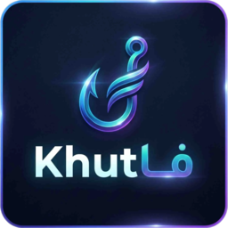
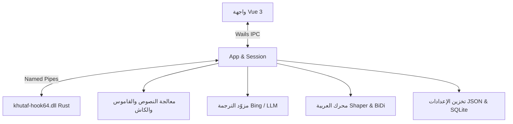

<p align="center">
  
</p>

<p align="center" style="font-size: 2em; font-weight: bold; margin: 15px 0 0 0;">خُطّاف — Khutaf</p>

<p align="center">
  أداة خفيفة وسريعة لويندوز هدفها الأساسي <strong>تسهيل الترجمة الفورية (Live Translation) إلى اللغة العربية</strong> لألعاب <strong>Unity (64-bit Mono &amp; IL2CPP)</strong>، وحقن الترجمة مباشرة داخل واجهة اللعبة لحظياً بدون تعديل ملفات اللعبة، مبنية باستخدام <strong>Go</strong> و<strong>Wails v2</strong> و<strong>Vue 3</strong> و<strong>Rust</strong>.
</p>

<p align="center">
  <strong>العربية</strong> | <a href="README.en.md">English</a>
</p>

[](https://github.com/user-attachments/assets/16eaacee-185e-48e4-a2b0-f3a556139d63)

---

## المميزات الأساسية

### 🎯 التقاط النصوص وتضمينها داخل اللعبة
* **مكتبة حقن أصلية بـ Rust:** اكتشاف عمليات ألعاب Unity (64-bit Mono وIL2CPP) وحقن `khutaf-hook64.dll` عبر `CreateRemoteThread` والتواصل ثنائي الاتجاه عبر الأنابيب المسماة (`Named Pipes`).
* **تحديد الـ Hooks بمرونة:** عرض جميع الـ Hooks المكتشفة مصنفة حسب موقع الاستدعاء (`#ctx`) مع النص الملتقط لحظياً، وتفعيل خيار **Embed** لكل Hook أو مصدر نصوص، مع حفظ إعدادات كل لعبة تلقائياً في `games.json`.
* **أوضاع عرض متعددة:** عرض الترجمة العربية فقط، أو النص الأصلي متبوعاً بالترجمة، أو العكس، مع خيار إزالة وسوم الشفافية للكتابة التدريجية (`<color=#00000000>`) لتحسين الأداء دون المساس بألوان النصوص الأخرى.

### ✍️ محرك تشكيل العربية والـ BiDi وحقن الخطوط
* **تشكيل سياقي كامل:** تحويل الحروف العربية إلى أشكالها السياقية (`U+FE80`–`U+FEFC` وForms-A) مع دمج اللام ألف (`لا`، `لأ`، `لإ`، `لآ`) والحفاظ على التشكيل.
* **ترتيب بصري ذكي (BiDi):** عكس الأسطر للعرض من اليمين لليسار مع الحفاظ على الكلمات الإنجليزية والأرقام والمتغيرات (`[var]`، `{var}`) ووسوم التنسيق (`<color=...>...</color>`) سليمة، وعكس الأقواس تلقائياً.
* **التفاف منطقي للأسطر:** تقسيم الجمل الطويلة على حدود الكلمات قبل عكس الترتيب البصري لتقرأ الصناديق الحوارية من الأعلى للأسفل بشكل صحيح.
* **دعم خطوط Unity (Mono & IL2CPP):** إنشاء خطوط ديناميكية من خطوط النظام (`Tahoma` افتراضياً) أو تمرير حزم `TMP_Font_AssetBundles` تلقائياً لظهور الحروف العربية بوضوح بدلاً من المربعات.

### 🌐 مزوّدو الترجمة ومعالجة النصوص والكاش
* **ترجمة Bing مجانية افتراضياً:** تعمل مباشرة بدون مفتاح API، مع دعم مزوّدين تقليديين إضافيين.
* **دعم نماذج الذكاء الاصطناعي (OpenAI-Compatible):** جاهز للعمل مع OpenAI وGemini وDeepSeek وGroq وOpenRouter، بالإضافة إلى التشغيل المحلي عبر Ollama و`llama.cpp` وLM Studio.
* **خط معالجة نصوص وكاش ثلاثي المستويات:** قواعد نصية وRegex قبل الترجمة وبعدها، وقاموس مصطلحات (عام ولكل لعبة)، وكاش SQLite (خاص باللعبة -> عام -> مشترك بين الألعاب) مع واجهة لإضافة وتعديل الترجمات يدوياً.

---

## التشغيل والبناء

### المتطلبات
* **Windows 10 / 11** (معمارية x64)
* **Go** (1.23 أو أحدث)
* **Rust** (Cargo + `msvc` toolchain) لبناء `runtime/khutaf-hook64.dll`
* **Node.js** و**npm**
* **Wails CLI v2**

### بناء مكتبة الحقن الأصلية
```powershell
powershell -ExecutionPolicy Bypass -File scripts/build-native.ps1
```

### التشغيل في وضع التطوير
```bash
wails dev
```

### بناء نسخة الإنتاج
```bash
wails build
```
> تأكد من وجود مجلد `runtime/` (يحتوي على `khutaf-hook64.dll`) بجانب الملف التنفيذي الناتج (`Khutaf.exe`).

---

## الأمان ومكافحة الغش والخصوصية
* **للألعاب الفردية (Offline Single-Player) فقط:** يعتمد خُطّاف على حقن مكتبة أصلية (`khutaf-hook64.dll`) عبر `CreateRemoteThread(LoadLibraryW)`. **لا تستخدمه** مع الألعاب الجماعية أونلاين أو الألعاب المحمية بأنظمة مكافحة الغش (مثل EasyAntiCheat أو BattlEye أو Riot Vanguard) تجنباً للحظر أو تعطل اللعبة.
* **خصوصية النصوص:** تُرسل نصوص اللعبة الملتقطة إلى مزوّد الترجمة الذي تختاره (Bing أو واجهة OpenAI المتوافقة). إذا كنت تفضل خصوصية كاملة دون اتصال بالإنترنت، استخدم وضع `llama.cpp` / Offline LLM المحلي.

---

## البنية التقنية



---

_انتظروا المزيد..._

ادعمنا عبر PayPal

[](https://paypal.me/mohammadmoustafa1)
