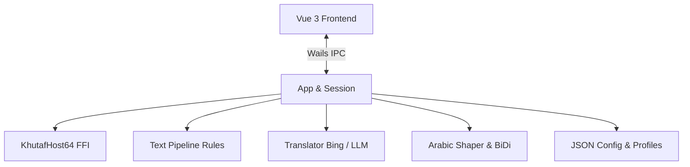

<p align="center">
  
</p>

<p align="center" style="font-size: 2em; font-weight: bold; margin: 15px 0 0 0;">Khutaf — خُطّاف</p>

<p align="center">
  A fast, lightweight Windows tool for hooking game text and embedding Arabic translations directly inside the game UI, powered by <strong>Go</strong>, <strong>Wails v2</strong>, and <strong>Vue 3</strong>.
</p>

<p align="center">
  <a href="README.md">العربية</a> | <strong>English</strong>
</p>

---

## Key Features

### 🎯 In-Game Text Hooking & Embedding
* **Direct Memory Hooking:** Enumerates running games (x64 & x86) and injects `KhutafHook` through a pure-Go, CGo-free FFI bridge to `KhutafHost64.dll`.
* **Live Hook Console:** Inspects discovered text threads with real-time captured text, per-hook **Embed** toggles, manual H-code insertion, and per-game profile persistence (`games.json`).
* **Flexible Display Modes:** Show Arabic translation only, original + translation, or translation + original with a configurable timeout.

### ✍️ Arabic RTL Engine & Unity Font Injection
* **Contextual Shaping:** Converts Arabic letters to Presentation Forms (`U+FE80`–`U+FEFC` & Forms-A), applies mandatory Lam-Alef ligatures, and preserves Tashkeel diacritics.
* **BiDi Visual Ordering:** Reverses RTL lines for engines without native Arabic support while keeping Latin words, numbers, `[vars]`, `{vars}`, and paired rich-text tags (`<color=...>...</color>`) intact and mirroring brackets.
* **Logical Line Wrapping:** Wraps text on word boundaries before visual reversal so multi-line dialogue boxes read top-to-bottom.
* **Unity Mono & IL2CPP Font Fallback:** Automatically passes `TMP_Font_AssetBundles` and OS font fallbacks (`Tahoma`, `Arial`) so Arabic renders cleanly instead of missing-glyph boxes.

### 🌐 Translation Providers & Text Pipeline
* **Free Bing Translator (Default):** Works out of the box with no API key required.
* **OpenAI-Compatible LLM Support:** Preconfigured presets for OpenAI, Gemini, DeepSeek, Groq, OpenRouter, Ollama, LM Studio, and `llama.cpp`.
* **Pre/Post Pipeline Rules:** Literal and regex cleanup rules before and after translation, plus `[..]` / `{..}` placeholder safety checks.

---

## Getting Started

### Prerequisites
* **Windows 10 / 11** (x64)
* **Go** (1.23 or later)
* **Node.js** & **npm**
* **Wails CLI v2**

### Development Run
```bash
wails dev
```

### Production Build
```bash
wails build
```
> Keep the `runtime/` directory next to the compiled `Khutaf.exe` executable.

---

## Technical Architecture



---

_Wait for more..._

Support me on PayPal

[](https://paypal.me/mohammadmoustafa1)
