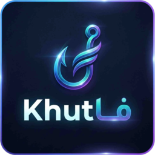
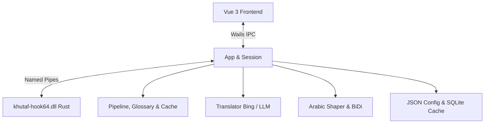

<p align="center">
  
</p>

<p align="center" style="font-size: 2em; font-weight: bold; margin: 15px 0 0 0;">Khutaf — خُطّاف</p>

<p align="center">
  A fast, lightweight Windows tool focused on making <strong>live Arabic translation</strong> effortless for PC games—hooking and embedding translations directly inside the game UI in real time without modifying game files. Currently supports <strong>64-bit Unity (Mono &amp; IL2CPP)</strong> games, with additional game engines planned on the roadmap. Powered by <strong>Go</strong>, <strong>Wails v2</strong>, <strong>Vue 3</strong>, and <strong>Rust</strong>.
</p>

<p align="center">
  <a href="README.md">العربية</a> | <strong>English</strong>
</p>

> There is no need to pre-translate the entire game, install extra game files, or tamper with the original game files. All you need to do is hook the game to capture its text-flow channels. Text channels are the internal data streams through which the game passes dialogues as they appear.
>
> Think of it like hidden pipes inside the game carrying text to display on screen. We don't touch the original reservoir (the game files); we simply place a filter (Khutaf) along that pipe. Whenever a line flows through to appear on your screen, Khutaf hooks it and translates it on the fly.

[](https://github.com/user-attachments/assets/278497ac-f4b8-4a1c-a0cc-e942f136d3a1)

---

## Download

Download the latest portable Windows release (`Khutaf.exe` + `runtime/khutaf-hook64.dll`) from [GitHub Releases (Latest)](https://github.com/MohammadAboulEla/Khutaf/releases/latest):

* Extract the archive anywhere while keeping `Khutaf.exe` and `runtime/khutaf-hook64.dll` together.
* Requires **Windows 10 / 11 (x64)** and **Microsoft Edge WebView2 Runtime**.
* Optionally download `TMP_Font_AssetBundles` from inside **Embed Settings** for Unity games lacking Arabic font glyphs.

---

## Key Features

### 🎯 In-Game Text Hooking & Embedding
* **Self-Authored Rust Hook DLL:** Enumerates running supported games (currently 64-bit Unity Mono & IL2CPP), injects `khutaf-hook64.dll` via `CreateRemoteThread(LoadLibraryW)`, and communicates over owner-only named pipes with per-session random pipe handshakes (`PROTO_VERSION = 2`).
* **Non-Blocking (Async) Translation & Smart Layout Rebuild:** Translates off the game's main thread and writes Arabic back on frame ticks (`Canvas::SendWillRenderCanvases` / `Camera::FireOnPreCull`) so gameplay never freezes, with batched ancestor `LayoutGroup` / `ContentSizeFitter` rebuilds (stopping strictly below any `Canvas`) so cards and tooltips expand smoothly to fit multi-line Arabic.
* **Smart Hook Classification & Unity Object Paths:** Extracts each hook's Unity `GameObject` hierarchy path, automatically classifies channels into `Dialogue` / `Speaker` / `UI` / `Noise` with a confidence score, provides 1-click presets (**Dialogue Only**, **Dialogue + UI**, **Disable All** + **Undo**), and persists per-game muted hooks (`MutedHooks`).
* **Temporary Session History & Upgraded `Ctrl+Alt+H` Picker:** Tracks the last 15 unique lines per hook with full-history search, live pulse indicators, inline history drawers, list **Freeze**, and instant translation reapply on toggle—powered by a unified `HookBrowser` across Simple, Advanced, and the keyboard-first floating picker (complete with quick display-mode, pause, and font-scale controls).
* **Low-Overhead Hook Path, Typewriter Debounce & Shareable Profiles:** Zero-allocation UTF-16 pre-filtering, incremental typewriter debounce (`180 ms`), timeout cooldown + circuit breaker, and sanitized `.khutaf.json` game profile export/import (no local paths or API keys).
* **Flexible Display & Typography:** Show translation only, original + translation, translation + original, or original only; relative font scaling; and optional stripping of invisible typewriter alpha tags (`<color=#00000000>`) while preserving visible colors.

### ✍️ Arabic RTL Engine & Font Injection
* **Contextual Shaping:** Converts Arabic letters to Presentation Forms (`U+FE80`–`U+FEFC` & Forms-A), applies mandatory Lam-Alef ligatures, and preserves Tashkeel diacritics.
* **Smart BiDi Visual Ordering & RTL Typewriter Reveal:** Reverses RTL lines for engines without native Arabic support while keeping Latin words, numbers, `[vars]`, `{vars}`, CamelCase placeholders, and paired rich-text tags (`<color=...>...</color>`) intact, and flips TextMeshPro `maxVisibleCharacters` typewriters to reveal Arabic cleanly right-to-left, top-to-bottom across multi-line and colored text.
* **Logical Line Wrapping:** Wraps text on word boundaries before visual reversal (optionally enforced on non-Arabic output) so multi-line dialogue boxes read top-to-bottom.
* **Font Fallback (Unity Mono & IL2CPP):** Dynamically creates OS TMP/UI fonts (`Tahoma` by default) and provides one-click in-app download of SHA-256-verified `TMP_Font_AssetBundles` (`arialuni_sdf_u*`) so Arabic renders cleanly instead of missing-glyph boxes.

### 🌐 Translation Providers, Pipeline, Cache & Diagnostics
* **Free Traditional Translators:** Bing Translator (default, no API key required), plus Google, Microsoft, Yandex, Papago, Youdao, Alibaba, Volcengine, LingoCloud, ModernMT, QQ TranSmart, QQIMT, and Translate.com.
* **OpenAI-Compatible, Offline Local LLMs & Rolling Story Context:** Presets for OpenAI, Gemini, DeepSeek, Groq, OpenRouter, Ollama, LM Studio, plus a built-in `llama.cpp` (`llama-server.exe`) runner (`HY-MT2`, `TranslateGemma`, `NLLB-Instruct`) that automatically injects recent translated dialogue turns and active speaker names to maintain Arabic gender, pronoun, and tone consistency.
* **Text Pipeline, Quick Glossary Capture & 3-Tier SQLite Cache:** Pre/post literal & regex rules, 1-click glossary capture directly from hook history or live feed, placeholder safety checks, and a 3-tier SQLite cache (per-game -> global -> cross-game shared fallback) with a built-in manual cache editor.
* **Diagnostics & Telemetry View:** Live per-subsystem telemetry stream, function latency matrix, and redacted JSONL diagnostic bundle export.

---

## Build from Source

### Prerequisites
* **Windows 10 / 11** (x64)
* **Go** (1.23 or later)
* **Rust** (Cargo + `msvc` toolchain) to build `runtime/khutaf-hook64.dll`
* **Node.js** & **npm**
* **Wails CLI v2**

### Build Native Hook DLL
```powershell
powershell -ExecutionPolicy Bypass -File scripts/build-native.ps1
```

### Development Run
```bash
wails dev
```

### Production Build
```bash
wails build
```
> Keep the `runtime/` directory (containing `khutaf-hook64.dll`) next to the compiled `Khutaf.exe` executable.

---

## Safety, Anti-Cheat & Privacy
* **Offline Single-Player Games Only:** Khutaf injects a native hook DLL (`khutaf-hook64.dll`) via `CreateRemoteThread(LoadLibraryW)` and includes built-in anti-cheat process detection warnings (e.g., EasyAntiCheat, BattlEye, Riot Vanguard). Do **not** attach to online multiplayer games or anti-cheat-protected titles, as DLL injection may trigger bans or crashes.
* **Local Security & Integrity:** API keys are encrypted at rest via Windows DPAPI, IPC named pipes and shared memory enforce owner-only ACLs, and downloaded font bundles are verified against pinned SHA-256 digests.
* **Translation Privacy:** Captured game dialogue is sent only to whichever translation provider you configure (Bing or your OpenAI-compatible endpoint). Use the built-in `llama.cpp` / Offline LLM mode for 100% local, offline translation.

---

## Technical Architecture



---

## License

Copyright (c) 2026 Mohammad AboulEla.  
Licensed under the [GNU General Public License v3.0 (GPL-3.0)](LICENSE).

---

_Wait for more..._

Support me on PayPal

[](https://paypal.me/mohammadmoustafa1)
