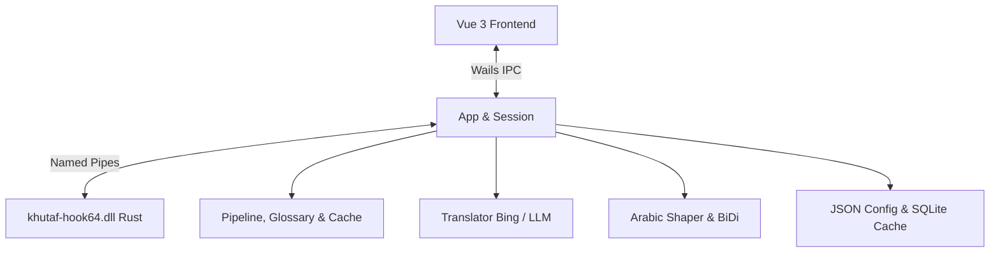

<p align="center">
  
</p>

<p align="center" style="font-size: 2em; font-weight: bold; margin: 15px 0 0 0;">Khutaf — خُطّاف</p>

<p align="center">
  A fast, lightweight Windows tool for hooking text in <strong>64-bit Unity (Mono &amp; IL2CPP)</strong> games and embedding Arabic translations directly inside the game UI, powered by <strong>Go</strong>, <strong>Wails v2</strong>, <strong>Vue 3</strong>, and <strong>Rust</strong>.
</p>

<p align="center">
  <a href="README.md">العربية</a> | <strong>English</strong>
</p>

---

## Key Features

### 🎯 In-Game Text Hooking & Embedding
* **Self-Authored Rust Hook DLL:** Enumerates running 64-bit Unity (Mono & IL2CPP) games, injects `khutaf-hook64.dll` via `CreateRemoteThread(LoadLibraryW)`, and communicates over bidirectional overlapped named pipes.
* **Live Hook Console:** Inspects discovered text hooks split by call-site `#ctx` with real-time captured text, per-hook **Embed** toggles, and per-game profile persistence (`games.json`).
* **Flexible Display Modes:** Show Arabic translation only, original + translation, or translation + original, plus an optional toggle to strip invisible typewriter alpha tags (`<color=#00000000>`) while preserving visible text colors.

### ✍️ Arabic RTL Engine & Unity Font Injection
* **Contextual Shaping:** Converts Arabic letters to Presentation Forms (`U+FE80`–`U+FEFC` & Forms-A), applies mandatory Lam-Alef ligatures, and preserves Tashkeel diacritics.
* **BiDi Visual Ordering:** Reverses RTL lines for engines without native Arabic support while keeping Latin words, numbers, `[vars]`, `{vars}`, and paired rich-text tags (`<color=...>...</color>`) intact and mirroring brackets.
* **Logical Line Wrapping:** Wraps text on word boundaries before visual reversal so multi-line dialogue boxes read top-to-bottom.
* **Unity Mono & IL2CPP Font Fallback:** Dynamically creates OS TMP/UI fonts (`Tahoma` by default) and optionally loads `TMP_Font_AssetBundles` fallbacks so Arabic renders cleanly instead of missing-glyph boxes.

### 🌐 Translation Providers, Pipeline & Cache
* **Free Bing Translator (Default):** Works out of the box with no API key required, alongside additional traditional web translators.
* **OpenAI-Compatible LLM Support:** Preconfigured presets for OpenAI, Gemini, DeepSeek, Groq, OpenRouter, Ollama, LM Studio, and `llama.cpp`.
* **Text Pipeline & 3-Tier Cache:** Pre/post literal & regex rules, global + per-game glossary, `[..]` / `{..}` placeholder safety checks, and SQLite translation cache (per-game -> global -> cross-game shared fallback) with a built-in manual cache editor.

---

## Getting Started

### Prerequisites
* **Windows 10 / 11** (x64)
* **Go** (1.23 or later)
* **Rust** (Cargo + `msvc` toolchain) to build `runtime/khutaf-hook64.dll`
* **Node.js** & **npm**
* **Wails CLI v2**

### Build Native Hook DLL
```powershell
powershell -ExecutionPolicy Bypass -File scripts/build-native.ps1
```

### Development Run
```bash
wails dev
```

### Production Build
```bash
wails build
```
> Keep the `runtime/` directory (containing `khutaf-hook64.dll`) next to the compiled `Khutaf.exe` executable.

---

## Technical Architecture



---

_Wait for more..._

Support me on PayPal

[](https://paypal.me/mohammadmoustafa1)
