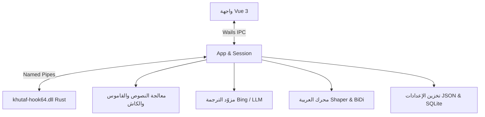

<p align="center">
  
</p>

<p align="center" style="font-size: 2em; font-weight: bold; margin: 15px 0 0 0;">خُطّاف — Khutaf</p>

<p align="center">
  أداة خفيفة وسريعة لويندوز هدفها الأساسي <strong>تسهيل الترجمة الفورية (Live Translation) إلى اللغة العربية</strong> لألعاب الكمبيوتر، وحقن الترجمة مباشرة داخل واجهة اللعبة لحظياً بدون تعديل ملفات اللعبة. يدعم هذا الإصدار حالياً ألعاب <strong>Unity (64-bit Mono &amp; IL2CPP)</strong> مع خطة لدعم محركات أخرى مستقبلاً، مبنية باستخدام <strong>Go</strong> و<strong>Wails v2</strong> و<strong>Vue 3</strong> و<strong>Rust</strong>.
</p>

<p align="center">
  <strong>العربية</strong> | <a href="README.en.md">English</a>
</p>

> لا حاجة لترجمة اللعبة بالكامل مسبقاً، أو تثبيت ملفات إضافية، أو التلاعب بملفات اللعبة الأصلية. كل ما عليك فعله هو ربط اللعبة بالبرنامج ليقوم بالتقاط قنوات تدفق النصوص. قنوات النصوص هي مسارات تدفق البيانات داخل اللعبة، ومن خلالها يلتقط البرنامج الحوارات فور ظهورها.
>
> تخيل إن اللعبة جواها مواسير مخفية بيمشي فيها الكلام عشان يروح يظهر على الشاشة. إحنا مبنغيرش الخزان الأصلي (ملفات اللعبة)، إحنا بس بنركب فلتر (الخُطاف) على الماسورة دي، وأي جملة بتعدي في الماسورة عشان تتعرض قدامك، الخُطاف بيلقطها ويترجمها فوراً في نفس اللحظة.

[](https://github.com/user-attachments/assets/278497ac-f4b8-4a1c-a0cc-e942f136d3a1)

---

## التحميل

يمكنك تحميل أحدث نسخة محمولة لويندوز (`Khutaf.exe` + `runtime/khutaf-hook64.dll`) من صفحة [GitHub Releases (الأحدث)](https://github.com/MohammadAboulEla/Khutaf/releases/latest):

* فك ضغط الأرشيف في أي مجلد مع الإبقاء على `Khutaf.exe` ومجلد `runtime/khutaf-hook64.dll` بجانب بعضهما.
* يتطلب **Windows 10 / 11 (x64)** ومكوّن **Microsoft Edge WebView2 Runtime**.
* يمكنك تحميل حزم الخطوط `TMP_Font_AssetBundles` بضغطة زر من داخل **Embed Settings** لألعاب Unity التي تفتقر للحروف العربية.

---

## المميزات الأساسية

### 🎯 التقاط النصوص وتضمينها داخل اللعبة
* **مكتبة حقن أصلية بـ Rust:** اكتشاف عمليات الألعاب المدعومة (حالياً Unity 64-bit Mono وIL2CPP) وحقن `khutaf-hook64.dll` عبر `CreateRemoteThread(LoadLibraryW)` والتواصل عبر أنابيب مسماة مقتصرة على المالك (`Owner-only Named Pipes`) بمصافحة عشوائية لكل جلسة (`PROTO_VERSION = 2`).
* **الترجمة غير الحاجزة (Async) وإعادة بناء التخطيط الذكية:** تتم الترجمة خارج المسار الرئيسي للعبة وتُكتب الترجمة العربية في إطار العرض التالي عبر (`Canvas::SendWillRenderCanvases` / `Camera::FireOnPreCull`) لمنع تجميد اللعب تماماً، مع إعادة بناء مجمّعة لحاويات `LayoutGroup` و`ContentSizeFitter` الأب (دون المساس بالـ `Canvas`) حتى تتمدد بطاقات القوائم والحوارات تلقائياً عند وصول الترجمة.
* **تصنيف ذكي للهوكس وقراءة مسارات Unity:** استخراج مسار عنصر الـ `GameObject` من شجرة Unity وتصنيف القنوات تلقائياً إلى (`حوار` / `متحدث` / `واجهة` / `ضوضاء`) مع درجة ترشيح وأزرار تفعيل بضغطة واحدة (**الحوارات فقط** / **الحوارات + الواجهة** / **إيقاف الكل** + **تراجع**) وإمكانية كتم القنوات المزعجة (`MutedHooks`).
* **سجل مؤقت للجلسة ونافذة اختيار سريعة (`Ctrl+Alt+H`):** الاحتفاظ بآخر 15 جملة لكل قناة مع البحث في السجل الكامل ومؤشر نبض حي وزر **تجميد القائمة** وتطبيق الترجمة فورياً لحظة التفعيل، ضمن مكوّن موحّد (`HookBrowser`) يدعم التنقّل الكامل بلوحة المفاتيح وشريط تحكم لحظي في نمط العرض والإيقاف المؤقت وحجم الخط.
* **أداء خفيف ومعالجة ذكية للكتابة التدريجية:** ترشيح أولي لنصوص UTF-16 دون حجز ذاكرة، وتأجيل ذكي (`Debounce`) للكتابة المتزايدة حرفاً بحرف، وفترة تهدئة بعد انتهاء المهلة وقاطع دائرة (`Circuit Breaker`)، وتبادل ملفات إعدادات الألعاب بصيغة `.khutaf.json` (خالية من المسارات المحلية ومفاتيح API).
* **أوضاع عرض وتحجيم مرنة:** عرض الترجمة فقط، أو الأصلي + الترجمة، أو الترجمة + الأصلي، أو الأصلي فقط، مع تحجيم نسبي للخط وخيار إزالة وسوم الشفافية للكتابة التدريجية (`<color=#00000000>`) مع الحفاظ على ألوان النصوص الأخرى.

### ✍️ محرك تشكيل العربية والـ BiDi وحقن الخطوط
* **تشكيل سياقي كامل:** تحويل الحروف العربية إلى أشكالها السياقية (`U+FE80`–`U+FEFC` وForms-A) مع دمج اللام ألف (`لا`، `لأ`، `لإ`، `لآ`) والحفاظ على التشكيل.
* **ترتيب بصري ذكي (BiDi) وكتابة تدريجية من اليمين لليسار (RTL Typewriter):** عكس الأسطر للعرض من اليمين لليسار مع الحفاظ على الكلمات الإنجليزية والأرقام والمتغيرات (`[var]`، `{var}`، ومعرّفات CamelCase) ووسوم التنسيق (`<color=...>...</color>`) سليمة، وعكس اتجاه الكتابة التدريجية في `TextMeshPro` (`maxVisibleCharacters`) لتظهر الحروف العربية من اليمين إلى اليسار ومن الأعلى للأسفل بشكل طبيعي.
* **التفاف منطقي للأسطر:** تقسيم الجمل الطويلة على حدود الكلمات قبل عكس الترتيب البصري (مع خيار تطبيقه على النصوص غير العربية أيضاً) لتقرأ الصناديق الحوارية من الأعلى للأسفل بشكل صحيح.
* **دعم الخطوط الاحتياطية (Unity Mono & IL2CPP):** إنشاء خطوط ديناميكية من خطوط النظام (`Tahoma` افتراضياً) مع تحميل حزم `TMP_Font_AssetBundles` (`arialuni_sdf_u*`) من داخل التطبيق والتحقق من بصمتها بـ SHA-256 لظهور الحروف العربية بوضوح بدلاً من المربعات.

### 🌐 مزوّدو الترجمة ومعالجة النصوص والكاش والتشخيص
* **مترجمات مجانية تقليدية:** Bing افتراضياً بدون مفتاح API، إلى جانب Google وMicrosoft وYandex وPapago وYoudao وAlibaba وVolcengine وLingoCloud وModernMT وQQ TranSmart وQQIMT وTranslate.com.
* **دعم نماذج الذكاء الاصطناعي وسياق الحوار المتصل:** جاهز للعمل مع OpenAI وGemini وDeepSeek وGroq وOpenRouter وOllama وLM Studio ومُشغّل مدمج لـ `llama.cpp` (`HY-MT2`، `TranslateGemma`، `NLLB-Instruct`)، مع تمرير تلقائي لآخر 5 جمل حوار مترجمة واسم المتحدث النشط للحفاظ على الضمائر والتذكير والتأنيث وأسلوب القصة.
* **خط معالجة نصوص وقاموس سريع وكاش SQLite ثلاثي المستويات:** قواعد نصية وRegex قبل الترجمة وبعدها، وإضافة سريعة للمصطلحات وأسماء الشخصيات إلى القاموس بضغطة زر من الحوار أو السجل، وفحص سلامة المتغيرات، وكاش SQLite ثلاثي المستويات (خاص باللعبة -> عام -> مشترك بين الألعاب) مع واجهة لتعديل الترجمات يدوياً.
* **شاشة التشخيص والقياس (Diagnostics & Telemetry):** بث حي لأحداث كل نظام فرعي، ومصفوفة أزمنة تنفيذ الدوال، وتصدير تقارير تشخيصية بصيغة JSONL مع حجب البيانات الحساسة تلقائياً.

---

## البناء من المصدر

### المتطلبات
* **Windows 10 / 11** (معمارية x64)
* **Go** (1.23 أو أحدث)
* **Rust** (Cargo + `msvc` toolchain) لبناء `runtime/khutaf-hook64.dll`
* **Node.js** و**npm**
* **Wails CLI v2**

### بناء مكتبة الحقن الأصلية
```powershell
powershell -ExecutionPolicy Bypass -File scripts/build-native.ps1
```

### التشغيل في وضع التطوير
```bash
wails dev
```

### بناء نسخة الإنتاج
```bash
wails build
```
> تأكد من وجود مجلد `runtime/` (يحتوي على `khutaf-hook64.dll`) بجانب الملف التنفيذي الناتج (`Khutaf.exe`).

---

## الأمان ومكافحة الغش والخصوصية
* **للألعاب الفردية (Offline Single-Player) فقط:** يعتمد خُطّاف على حقن مكتبة أصلية (`khutaf-hook64.dll`) عبر `CreateRemoteThread(LoadLibraryW)` ويتضمن فحصاً مدمجاً لتنبيهك عند وجود عمليات مكافحة غش (مثل EasyAntiCheat أو BattlEye أو Riot Vanguard). **لا تستخدمه** مع الألعاب الجماعية أونلاين أو المحمية بمكافحة الغش تجنباً للحظر أو تعطل اللعبة.
* **الأمان المحلي والسلامة:** تُشفَّر مفاتيح API محلياً عبر Windows DPAPI، وتُقيَّد صلاحيات الأنابيب المسماة والذاكرة المشتركة بمالك الجلسة فقط، ويُتحقق من تكامل حزم الخطوط المحمّلة ببصمة SHA-256.
* **خصوصية النصوص:** تُرسل نصوص اللعبة الملتقطة فقط إلى مزوّد الترجمة الذي تختاره (Bing أو واجهة OpenAI المتوافقة). إذا كنت تفضل خصوصية كاملة دون اتصال بالإنترنت، استخدم وضع `llama.cpp` / Offline LLM المحلي.

---

## البنية التقنية



---

## الرخصة

Copyright (c) 2026 Mohammad AboulEla.  
مرخّص تحت رخصة [GNU General Public License v3.0 (GPL-3.0)](LICENSE).

---

_انتظروا المزيد..._

ادعمنا عبر PayPal

[](https://paypal.me/mohammadmoustafa1)
