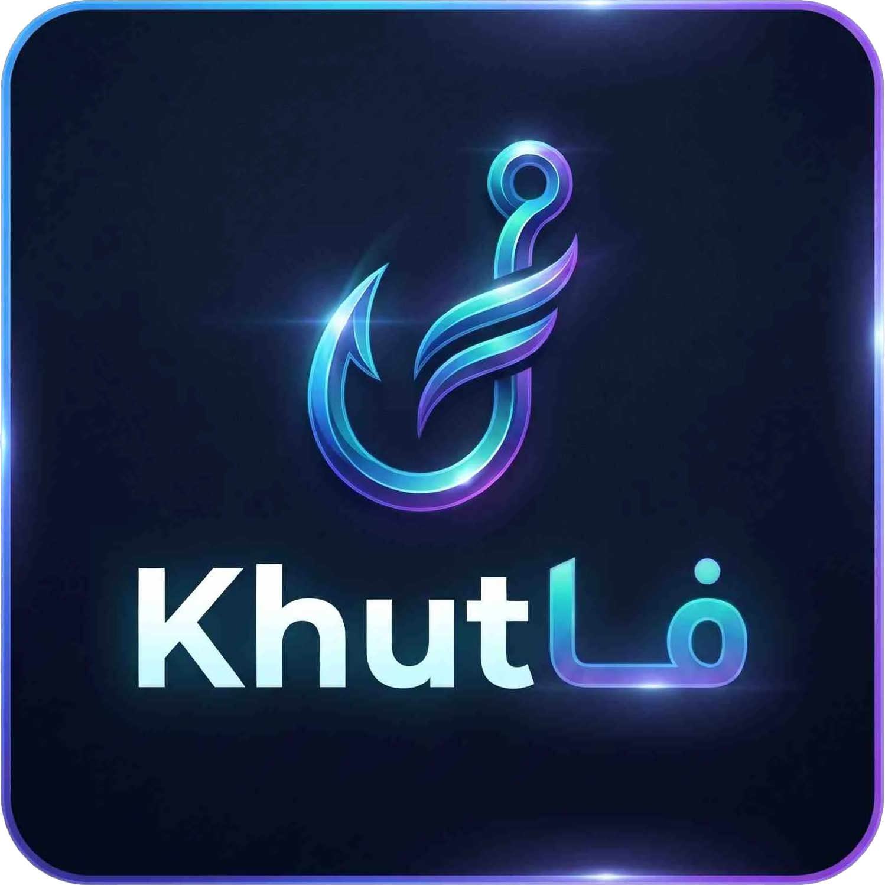
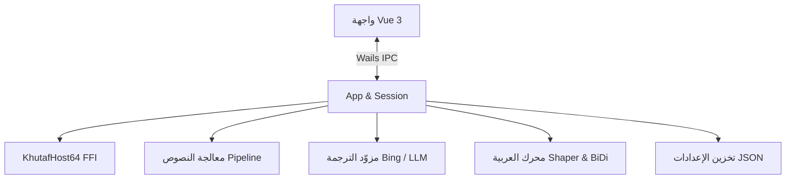

<p align="center">
  
</p>

<p align="center" style="font-size: 2em; font-weight: bold; margin: 15px 0 0 0;">خُطّاف — Khutaf</p>

<p align="center">
  أداة خفيفة وسريعة لويندوز لترجمة الألعاب إلى العربية وحقن الترجمة مباشرة داخل واجهة اللعبة نفسها، مبنية باستخدام <strong>Go</strong> و<strong>Wails v2</strong> و<strong>Vue 3</strong>.
</p>

<p align="center">
  <strong>العربية</strong> | <a href="README.en.md">English</a>
</p>

---

## المميزات الأساسية

### 🎯 التقاط النصوص وتضمينها داخل اللعبة
* **اتصال مباشر بذاكرة اللعبة:** اكتشاف العمليات النشطة (x64 وx86) وحقن `KhutafHook` عبر جسر FFI خالص في Go بدون CGo (`KhutafHost64.dll`).
* **تحديد الـ Hooks بمرونة:** عرض جميع الـ Hooks المكتشفة مع النص الملتقط لحظياً، وتفعيل خيار **Embed** للـ Hook المطلوب، وإدخال أكواد H-code يدوياً، مع حفظ إعدادات كل لعبة تلقائياً في `games.json`.
* **أوضاع عرض متعددة:** عرض الترجمة العربية فقط، أو النص الأصلي متبوعاً بالترجمة، أو العكس، مع مهلة زمنية قابلة للتخصيص.

### ✍️ محرك تشكيل العربية والـ BiDi وحقن الخطوط
* **تشكيل سياقي كامل:** تحويل الحروف العربية إلى أشكالها السياقية (`U+FE80`–`U+FEFC` وForms-A) مع دمج اللام ألف (`لا`، `لأ`، `لإ`، `لآ`) والحفاظ على التشكيل.
* **ترتيب بصري ذكي (BiDi):** عكس الأسطر للعرض من اليمين لليسار مع الحفاظ على الكلمات الإنجليزية والأرقام والمتغيرات (`[var]`، `{var}`) ووسوم التنسيق (`<color=...>...</color>`) سليمة، وعكس الأقواس تلقائياً.
* **التفاف منطقي للأسطر:** تقسيم الجمل الطويلة على حدود الكلمات قبل عكس الترتيب البصري لتقرأ الصناديق الحوارية من الأعلى للأسفل بشكل صحيح.
* **دعم خطوط Unity (Mono & IL2CPP):** تمرير حزم `TMP_Font_AssetBundles` وخطوط النظام (مثل `Tahoma` و`Arial`) تلقائياً لظهور الحروف العربية بوضوح بدلاً من المربعات.

### 🌐 مزوّدو الترجمة ومعالجة النصوص
* **ترجمة Bing مجانية افتراضياً:** تعمل مباشرة بدون مفتاح API.
* **دعم نماذج الذكاء الاصطناعي (OpenAI-Compatible):** جاهز للعمل مع OpenAI وGemini وDeepSeek وGroq وOpenRouter، بالإضافة إلى التشغيل المحلي عبر Ollama و`llama.cpp` وLM Studio.
* **خط معالجة نصوص (Pre/Post Pipeline):** قواعد نصية وRegex قبل الترجمة وبعدها، مع فحص أمان المتغيرات `[..]` و`{..}` لمنع تعطل اللعبة.

---

## التشغيل والبناء

### المتطلبات
* **Windows 10 / 11** (معمارية x64)
* **Go** (1.23 أو أحدث)
* **Node.js** و**npm**
* **Wails CLI v2**

### التشغيل في وضع التطوير
```bash
wails dev
```

### بناء نسخة الإنتاج
```bash
wails build
```
> تأكد من وجود مجلد `runtime/` بجانب الملف التنفيذي الناتج (`Khutaf.exe`).

---

## البنية التقنية



---

_انتظروا المزيد..._

ادعمنا عبر PayPal

[](https://paypal.me/mohammadmoustafa1)
