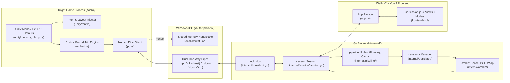

# Khutaf Architecture & Engineering Reference

## 1. System Architecture & Data Flow

Khutaf translates in-game text in real time by injecting a Rust hook DLL into a target 64-bit Windows game process, streaming text over named pipes to a Go backend (`Session`), processing/translating/shaping Arabic text, and presenting controls and telemetry in a Wails v2 + Vue 3 desktop UI.

### Synchronous vs. Non-Blocking Embed Flow

1. **Text interception:** A Unity detour calls `embed::process_unity` (`native/khutaf-hook/src/embed.rs`) after stripping TMP/rich-text tags (if `is_tmp_like_tags(hook_id)`) and checking `OWN_OUTPUT_HISTORY` to avoid re-translating text Khutaf itself wrote back.
2. **Synchronous mode (`NonBlocking = false`):** The DLL sends `Msg::EmbedRequest` and blocks the calling game thread on a condition variable up to `Settings.wait_ms`. In Go, `Session.OnEmbedText` queues an `embedJob` onto `embedCh`; `Session.handleEmbed` runs pre-rules, glossary (`Apply` or `WithGlossaryPrompt`), rolling dialogue story context (`WithDialogueContext` for LLM/Offline LLM providers), `translator.Manager.TranslateValidated` (with `90%` of `TimeoutMs` budget), post-rules, placeholder validation, and `arabic.Process`, then sends `Msg::EmbedResponse`.
3. **Non-blocking mode (`NonBlocking = true`):** `process_unity` detects incremental letter-by-letter typewriter streams (`180 ms` debounce) or enqueues an `AsyncTarget` (pinning the Unity component via `gchandle_pin`), returns `Settings.pending_text` (or keeps original text if empty) immediately, and lets `Session.handleEmbed` run with at least a `12s` timeout. When `Msg::EmbedResponse` arrives, it queues a `ReadyUpdate`; on the next `on_frame_tick` (`Canvas::SendWillRenderCanvases` or `Camera::FireOnPreCull`), `unity::mod::flush_async_updates` writes the shaped Arabic back, runs `font::on_text`, refreshes `TMP_Text.ForceMeshUpdate`, marks ancestor `ILayoutGroup` / `ILayoutSelfController` containers dirty (stopping strictly before any `Canvas`), and performs a deduplicated `LayoutRebuilder.ForceRebuildLayoutImmediate` pass once per layout root. Enabling a hook via `SetEmbed(true)` also queues an immediate `reapply_enabled_hooks` pass on the next frame tick, and `detour_tmp_set_max_visible_chars` flips TextMeshPro `maxVisibleCharacters` reveals to right-to-left top-to-bottom via `<alpha=#00>…<alpha=#FF>` masking.

---

## 2. Cross-Layer Contracts

### 2.1 IPC Wire Protocol (`PROTO_VERSION = 2`)

- **Dual implementations (keep in sync):** [`native/khutaf-proto/src/lib.rs`](../native/khutaf-proto/src/lib.rs) and [`internal/hook/proto.go`](../internal/hook/proto.go). Golden bytes are verified in `internal/hook/proto_test.go` and `khutaf-proto` unit tests.
- **Framing:** `u32 len | u8 type | payload` (little-endian; `len` includes type byte + payload; `MAX_FRAME = 16 MiB`). Strings are `u32 utf16_unit_count` followed by UTF-16LE code units; booleans are 1 byte (`0`/`1`).
- **Handshake:** `internal/hook/host.go` creates `Local\khutaf_ipc_<pid>` (64-byte block: magic `"KHUT"`, version `1`, `pid`, `nonce_len = 32`, 32-byte ASCII hex nonce) and opens `\\.\pipe\khutaf_<pid>_<nonce>_up` (DLL → host) and `_down` (host → DLL) with owner-only security descriptors.

| Kind | Direction | Payload Summary |
| :--- | :--- | :--- |
| `0x01` `Hello` | DLL → Host | `proto (u32)`, `pid (u32)`, `arch (u8)`, `engine (str)`, `unity_version (str)` |
| `0x02` `HookAdded` | DLL → Host | `hook_id (u64)`, `code (str)`, `name (str)`, `embeddable (bool)` |
| `0x03` `HookRemoved` | DLL → Host | `hook_id (u64)` |
| `0x04` `Text` | DLL → Host | `hook_id (u64)`, `ctx (u64)`, `ctx2 (u64)`, `text (str)` |
| `0x05` `EmbedRequest` | DLL → Host | `req_id (u64)`, `hook_id (u64)`, `ctx (u64)`, `ctx2 (u64)`, `text (str)` |
| `0x06` `Log` | DLL → Host | `level (u8: 0..3)`, `msg (str)` (also carries `[telemetry\|...]`, `[meta\|<hook_id>\|<ctx_hex>\|<ctx2_hex>] <path>`, and `[perf] ...`) |
| `0x81` `Settings` | Host → DLL | `wait_ms`, `display_mode`, `font_family`, `font_dir`, `clear_text`, `change_font_size`, `font_scale`, `strip_typewriter_tags`, `non_blocking`, `pending_text`, optional trailing `verbose_hooks` |
| `0x82` `SetEmbed` | Host → DLL | `hook_id (u64)`, `ctx (u64)`, `ctx2 (u64)`, `on (bool)` |
| `0x83` `EmbedResponse` | Host → DLL | `req_id (u64)`, `has_text (bool)`, optional `text (str)` (`false`/`None` keeps original) |
| `0x84` `Detach` | Host → DLL | *(empty)* |

> Note: `Settings` reads `verbose_hooks` conditionally if trailing bytes remain in the frame (`if d.pos < d.buf.len()` / `if len(d.b) > 0`), preserving backward decoding compatibility.

### 2.2 Wails Event Contract

All 15 events subscribed in [`frontend/src/composables/useSession.js`](../frontend/src/composables/useSession.js):

| Event Name | Emitter Source | Payload |
| :--- | :--- | :--- |
| `session:status` | `internal/session/session.go` (`EventStatus`) | `session.Status` |
| `config:updated` | `internal/session/session.go` (`EventConfigUpdated`) | `config.Config` |
| `hooks:popup` | `app.go` | `{ open: bool, standalone: bool }` |
| `hotkey:toast` | `app.go` via `session.EventHotkeyToast` | Hotkey toast object (`{ label, ... }`) |
| `unityfonts:progress` | `internal/session/unity_fonts.go` | `session.UnityFontStatus` |
| `updater:status` | `internal/updater/updater.go` | `updater.Status` |
| `translator:bench:item` | `internal/session/benchmark.go` (`EventBenchmarkItem`) | Benchmark item with `runId`, `providerId` |
| `translator:bench:done` | `internal/session/benchmark.go` (`EventBenchmarkDone`) | Summary with `runId`, `items`, `total` |
| `hook:new` | `internal/session/session.go` (`EventHookNew`) | `session.HookView` |
| `hook:remove` | `internal/session/session.go` (`EventHookDel`) | Hook `key` string |
| `hook:output` | `internal/session/session.go` (`EventHookText`) | `{ key, text, atMs, category, dialogueScore, hitCount, updatesPerSec, lastSeenMs, objectPath }` |
| `embed:line` | `internal/session/session.go` (`EventEmbedLine`) | `session.EmbedLine` |
| `log` | `internal/session/session.go` (`EventLog`) | `{ level, msg, time }` |
| `debug:trace` | `internal/session/session.go` (`EventDebugTrace`) | `session.DebugTrace` |
| `telemetry:batch` | `internal/session/session.go` (`EventTelemetryBatch`) | `session.TelemetryBatch` |

### 2.3 Config, Per-Game Profiles & Secrets

- **Storage (`internal/config/config.go`):** Portable `userconfig/` directory next to the executable (`config.json`, `games.json`, `glossary.json`). If `primaryDir` is not writable, `app.go` falls back to `%TEMP%\Khutaf` or `config.NewMemoryStore()`.
- **Overrides & Shareable Profiles:** `GameProfile` in `games.json` supports `EmbedHooks` (with optional `Path`/`Label`, auto-re-enabled on `OnHookInsert`), `MutedHooks`, `Pipeline`, `EmbedOverride`, `TranslatorOverride`, and `AutoAttach`. Sanitized `.khutaf.json` profile export/import (`internal/session/profile_io.go`) omits local paths and translator credentials.
- **Secrets:** `LLMSettings.APIKey` is encrypted/decrypted with Windows DPAPI (`dpapi:` prefix) in `internal/config/dpapi_windows.go`.

### 2.4 Unity Hook Registry (`native/khutaf-hook/src/unity/mod.rs`)

| ID | Constant | Hook Code (`HookAdded.code`) | Notes |
| :--- | :--- | :--- | :--- |
| `1` | `HOOK_TMP_SET_TEXT` | `UNITY:TMP_Text.set_text` | `is_tmp_hook` |
| `2` | `HOOK_TMP_SETTEXT` | `UNITY:TMP_Text.SetText` | `is_tmp_hook` (1-arg & 2-arg overloads) |
| `3` | `HOOK_UI_TEXT_SET_TEXT` | `UNITY:UI.Text.set_text` | `is_ui_text_hook` |
| `4` | `HOOK_TEXTMESH_SET_TEXT` | `UNITY:TextMesh.set_text` | Legacy 3D TextMesh |
| `5` | `HOOK_TEXTMESHPRO_SET_TEXT` | `UNITY:TextMeshPro.set_text` | `is_tmp_hook` |
| `6` | `HOOK_TEXTMESHPRO_UGUI_SET_TEXT` | `UNITY:TextMeshProUGUI.set_text` | `is_tmp_hook` |
| `7` | `HOOK_TEXTMESHPRO_UGUI_SETTEXT` | `UNITY:TextMeshProUGUI.SetText` | `is_tmp_hook` |
| `8` | `HOOK_UIE_TEXTELEMENT_SET_TEXT` | `UNITY:TextElement.set_text` | UI Toolkit |
| `9` | `HOOK_UIE_TEXTFIELD_SET_VALUE` | `UNITY:TextField.set_value` | UI Toolkit |
| `10` | `HOOK_GUITEXT_SET_TEXT` | `UNITY:GUIText.set_text` | Legacy `GUIText` |
| `11` | `HOOK_NGUILABEL_SET_TEXT` | `UNITY:UILabel.set_text` | NGUI `UILabel` |
| `12` | `HOOK_TMP_STATIC_UI` | `UNITY:TMP.StaticUI` | `VerboseHooks` (`OnEnable` + active scene scan, `ctx == 0 && ctx2 == 0`) |
| `13` | `HOOK_UI_TEXT_STATIC_UI` | `UNITY:UI.Text.StaticUI` | `VerboseHooks` (`OnEnable` + active scene scan, `ctx == 0 && ctx2 == 0`) |
| `14` | `HOOK_FEBUCCI_TEXTANIMATOR_SET_TEXT` | `UNITY:TextAnimator.SetText` | Conditional on `Febucci.UI.TextAnimator`; `is_tmp_like_tags`, resolves `get_tmproText()` |

---

## 3. Change Recipes

### Recipe A: Add a New Translator Provider
1. **Backend implementation:**
   - *Free traditional web provider:* Create `internal/translator/traditional/<id>.go` implementing `traditional.Provider`, and register it in `New()` inside [`internal/translator/traditional/common.go`](../internal/translator/traditional/common.go).
   - *Custom-configured provider:* Implement `translator.Provider` in `internal/translator/`, add settings struct/fields to `TranslatorSettings` & `Default()` in [`internal/config/config.go`](../internal/config/config.go), and wire it in `BuildProvider()` inside [`internal/translator/manager.go`](../internal/translator/manager.go).
2. **Tests:** Add unit tests in `internal/translator/` or `internal/translator/traditional/traditional_test.go`.
3. **Frontend registry & UI:** Add `{ id, label }` to `TRADITIONAL_PROVIDERS` or `ALL_PROVIDERS` in [`frontend/src/utils/providers.js`](../frontend/src/utils/providers.js). If custom config fields exist, update [`frontend/src/views/TranslatorsView.vue`](../frontend/src/views/TranslatorsView.vue) and add matching keys to [`frontend/src/i18n/en.js`](../frontend/src/i18n/en.js) and [`frontend/src/i18n/ar.js`](../frontend/src/i18n/ar.js).

### Recipe B: Add or Modify an IPC Message or `Settings` Field
1. Update [`native/khutaf-proto/src/lib.rs`](../native/khutaf-proto/src/lib.rs) (`Msg` / `Settings`, `encode`, `decode`, unit tests). For additive `Settings` fields, prefer trailing optional decoding to preserve compatibility.
2. Mirror the exact binary layout in [`internal/hook/proto.go`](../internal/hook/proto.go) and update `internal/hook/proto_test.go`.
3. Update Go structs/dispatch in [`internal/hook/types.go`](../internal/hook/types.go), [`internal/hook/host.go`](../internal/hook/host.go), and `Session.pushEmbedSettings` in [`internal/session/embed.go`](../internal/session/embed.go).
4. Handle the field/message in [`native/khutaf-hook/src/ipc.rs`](../native/khutaf-hook/src/ipc.rs) and [`native/khutaf-hook/src/embed.rs`](../native/khutaf-hook/src/embed.rs).
5. Rebuild the DLL with `powershell -ExecutionPolicy Bypass -File scripts/build-native.ps1` and run `cargo test`, `cargo clippy`, and `go test -race -count=1 ./...`.

### Recipe C: Add a Wails RPC Method or Event
1. Implement business logic in `internal/session/` (or the relevant `internal/` package) and expose the method on `App` in [`app.go`](../app.go) (or the relevant `app_*.go` file).
2. For events, define an `Event*` constant in [`internal/session/session.go`](../internal/session/session.go), emit via `s.post(...)`, and subscribe in the corresponding domain composable (`useHooks.js`, `useConfig.js`, `useUpdater.js`, `useUnityFonts.js`, `useBenchmark.js`, `useTelemetry.js`, or `useSession.js`).
3. Wrap the new `App` method via `callApp("MethodName", ...)` in the domain composable / `useSession.js` and expose it to views/components.
4. Verify `npm --prefix frontend test`, `npm --prefix frontend run build`, and `wails build` (which updates `frontend/wailsjs/`).

### Recipe D: Add a New Unity Text Hook
1. Allocate the next unused `HOOK_*` constant (`>= 15`) in [`native/khutaf-hook/src/unity/mod.rs`](../native/khutaf-hook/src/unity/mod.rs); never change `1..=14`.
2. Update `is_tmp_hook`, `is_tmp_like_tags`, `is_ui_text_hook`, or `resolve_font_target` in `unity/mod.rs` if the component wraps TMP/UI Text or uses rich-text tags.
3. Install the method detour in both [`native/khutaf-hook/src/unity/mono.rs`](../native/khutaf-hook/src/unity/mono.rs) and [`native/khutaf-hook/src/unity/il2cpp.rs`](../native/khutaf-hook/src/unity/il2cpp.rs), emitting `record_and_emit_hook(id, "UNITY:...", "...")`.
4. Add a human-readable EN/AR label rule in [`frontend/src/utils/hookLabels.js`](../frontend/src/utils/hookLabels.js) and check `isUnityTextHook` in [`internal/session/smart_embed.go`](../internal/session/smart_embed.go) if smart auto-embed should recognize it.
5. Rebuild `runtime/khutaf-hook64.dll` via `scripts/build-native.ps1`.

### Recipe E: Add a New Setting & UI Control
1. Add the JSON-tagged field to the appropriate struct and `Default()` in [`internal/config/config.go`](../internal/config/config.go), plus tests in `internal/config/config_test.go`.
2. Propagate to `Session` / `Host` / `khutaf-proto` if it affects native hooking (see Recipe B).
3. Bind the control in the target Vue view/modal (`EmbedSettingsView.vue`, `TranslatorsView.vue`, etc.), honoring `isSimple` mode gating if applicable.
4. Add matching translation keys to both [`frontend/src/i18n/en.js`](../frontend/src/i18n/en.js) and [`frontend/src/i18n/ar.js`](../frontend/src/i18n/ar.js), then run `npm --prefix frontend test`.

---

## 4. Debugging & Troubleshooting Guide

### Telemetry, Debug Traces & Diagnostic Bundles
- **Per-stage latency (`DebugTrace`):** Enabling Debug Mode emits `debug:trace` events from `Session.handleEmbed` with microsecond breakdowns (`preRulesUs`, `translateUs`, `postRulesUs`, `shapeUs`, `callbackUs`, `totalUs`) plus native `[perf] <metric>: <us> us` traces via `DebugView.vue`.
- **Structured telemetry (`internal/session/telemetry.go`):** Native `crate::telemetry(...)` and Go `Session.RecordSpan` feed a `2000`-event ring buffer and `FunctionHealthStats` matrix across 6 subsystems (`HOOK_NATIVE`, `UNITY_FONT`, `IPC_PIPE`, `PIPELINE_CACHE`, `TRANSLATOR`, `ARABIC_SHAPER`), flushed via `telemetry:batch`.
- **Diagnostic bundle:** `App.ExportDiagnosticBundle()` writes a redacted `khutaf-diagnostic-*.jsonl` file (status, sanitized config with API keys masked as `"***"`, health stats, telemetry events, and `llama-server` logs).

### Common Failure Playbook

| Symptom | Where to Inspect | Likely Cause & Fix Direction |
| :--- | :--- | :--- |
| Attach / injection fails or times out | `internal/hook/{process,inject,host}.go`, `native/khutaf-hook/src/ipc.rs` | Target process is 32-bit (`khutaf-hook64.dll` is x64 only), game runs elevated while Khutaf is not, or pipe/shared-memory handshake timed out (`5s` retry window in `ipc.rs`). |
| Static menus/labels missing | `embed.rs` (`VERBOSE_SCAN_PENDING`), `unity/{mod,mono,il2cpp}.rs` | `VerboseHooks` disabled, or component populated `m_text` after `OnEnable`; check `scan_active_static_ui` and frame-tick wakeups. |
| Dialogue missing or collapsed into one hook | `unity/mod.rs` (`caller_rel_ctx`), `il2cpp.rs` / `mono.rs` | Text routed through middleware (`Febucci.UI.TextAnimator`, `I2.Loc`) or alternative setter (`SetCharArray`). See [`unity6-textanimator-and-layout-report.md`](unity6-textanimator-and-layout-report.md). |
| Arabic renders as boxes, unshaped, or 1–2 chars/line | `internal/arabic/`, `unity/font.rs`, `unity/mod.rs` | Missing `TMP_Font_AssetBundles` (check `UnityFontStatus`), OS font missing Arabic glyphs, or narrow pre-measured `RectTransform` wrapping text before async writeback (`ensure_text_layout` + `rebuild_component_layout`). |
| Translation timeouts or dropped calls | `internal/translator/manager.go`, `internal/session/session.go` | `TimeoutMs` too tight for blocking mode (increase timeout or enable `NonBlocking`), `maxConcurrentRequests = 4` saturation, or circuit breaker tripped in `embed.rs` (`CB_THRESHOLD = 3`, `CB_OPEN_DURATION = 8s`). |
